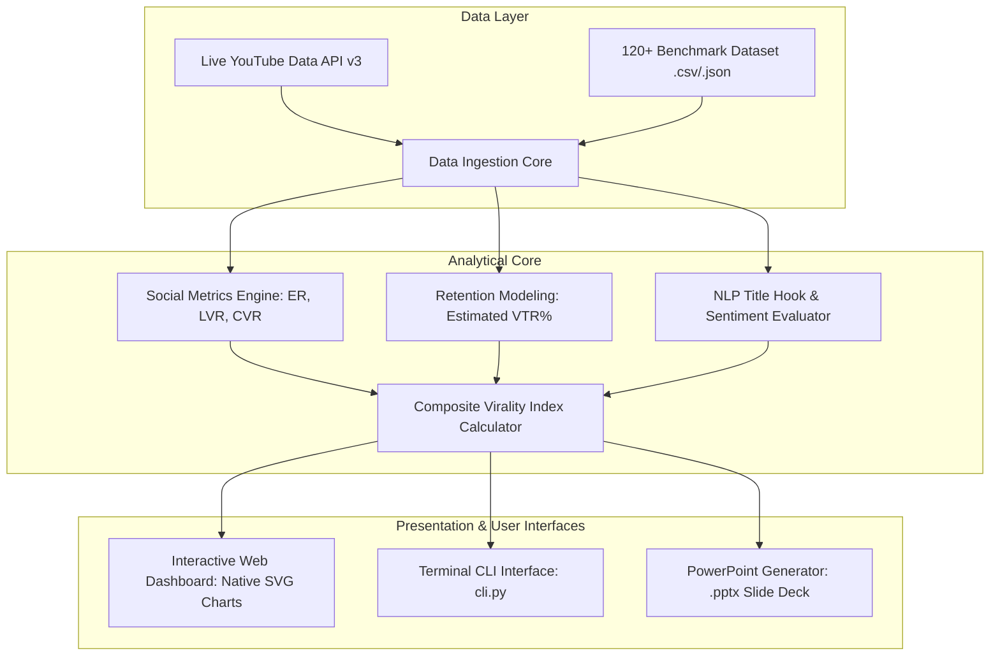

# 📱 YouTube Shorts Performance Analysis & Virality Prediction Platform

[](https://www.python.org/)
[]()
[]()
[]()
[]()
[]()
[](presentation/YouTube_Shorts_Performance_Analysis.pptx)

A comprehensive, ready-to-use, zero-dependency analytics and prediction platform for **YouTube Shorts** built for the academic university subject **Social Media (Social Media Analytics & Marketing)** at **Parul University** by **Thota Abhiram**.

Includes an **Interactive Animated Web Dashboard**, a **Real-Time YouTube Data API v3 Client**, a **Cross-Platform CLI**, a **Title Hook NLP Engine**, **Unit Test Suites**, and a **Ready-to-Present 10-Slide Academic PowerPoint Presentation (`.pptx`)**.

---

## 🚀 Key Highlights & Capabilities

- ⚡ **Zero External Dependencies**: Runs entirely on the Python Standard Library (`urllib.request`, `http.server`, `json`, `csv`, `math`, `zipfile`, `xml`). No `pip install` required! Works out-of-the-box on any machine.
- 🌐 **Live YouTube Data API v3 Integration**: Direct HTTPS client using Google's official API to query live YouTube Shorts, titles, view counts, like counts, and comments in real-time.
- 📊 **Curated 120+ Item Benchmark Dataset**: Pre-compiled rich dataset across 6 core social niches (Technology & AI, Education, Gaming, Entertainment, Finance, and Lifestyle).
- 🧮 **Rigorous Social Media Metric Formulations**:
  - **Engagement Rate (ER%)**: $\frac{\text{Likes} + \text{Comments}}{\text{Views}} \times 100\%$
  - **Estimated View-Through Rate (VTR% / Retention)**: Models viewer loop velocity and swipe-away drop-off.
  - **Composite Virality Index Score (0 to 100)**: Multi-factor weighted algorithmic model.
- 🎯 **NLP Title Hook Evaluator**: Automated scoring of curiosity gaps, psychological power words, numerical specificity, and character length optimization.
- 📈 **Interactive Modern Web Dashboard**: Responsive dark-mode dashboard featuring custom SVG visualizations (Category benchmarks, Duration vs VTR curve, Hashtags, and Best Publishing Hours heatmap).
- 🤖 **Interactive Virality Predictor**: Live simulation tool for creators to test Short titles and durations before publishing.
- 🎓 **Ready-to-Present PowerPoint Deck**: High-impact 10-slide `.pptx` presentation file (`presentation/YouTube_Shorts_Performance_Analysis.pptx`) + full speaker notes and Viva Voce Q&A guide (`presentation/PRESENTATION_NOTES.md`).

---

## 🏛️ System Architecture



---

## 📐 Mathematical Formulation

### 1. Engagement Rate (ER%)
$$\text{ER} = \left( \frac{\text{Likes} + \text{Comments}}{\text{Views}} \right) \times 100$$
*Measures total viewer participatory reaction relative to view scale.*

### 2. Estimated View-Through Rate (VTR% / Retention Proxy)
Short-form recommendation algorithms heavily prioritize audience retention and replay loops. VTR is modeled as:
$$\text{Estimated VTR} = \text{BaseRetention}(\text{DurationTier}) + \Delta_{\text{hook}} + \Delta_{\text{ER}}$$
- **Ultra-Short (≤15s)**: Base VTR $\approx 86\%$
- **Standard Short (16-30s)**: Base VTR $\approx 74\%$
- **Mid-Length (31-45s)**: Base VTR $\approx 60\%$
- **Long-Form Short (46-60s)**: Base VTR $\approx 48\%$

### 3. Composite Virality Index Score (0 - 100)
$$\text{Virality Score} = 0.30 \cdot S_{\text{views}} + 0.25 \cdot S_{\text{ER}} + 0.25 \cdot S_{\text{retention}} + 0.10 \cdot S_{\text{hook}} + 0.10 \cdot S_{\text{comments}}$$

- $S_{\text{views}}$: Logarithmic normalization ($\log_{10}(\text{Views})$) from 1K to 10M+ views.
- $S_{\text{ER}}$: Scaled engagement rate calibrated to category benchmark.
- $S_{\text{retention}}$: Retention probability score.
- $S_{\text{hook}}$: Title hook strength (0 to 100) based on power words, numbers, and curiosity gaps.
- $S_{\text{comments}}$: Conversation velocity multiplier.

---

## 📂 Project Directory Structure

```text
├── core/
│   ├── __init__.py
│   ├── analyzer.py             # Statistical computation engine (ER, VTR, Virality Score)
│   ├── dataset_generator.py    # Benchmark dataset generator & CSV/JSON loader
│   ├── sentiment.py            # Title hook NLP and sentiment polarity engine
│   └── youtube_api.py          # Zero-dependency YouTube Data API v3 client
├── data/
│   ├── shorts_dataset.csv      # 120+ YouTube Shorts records with 10 features
│   └── shorts_dataset.json     # JSON mirror format of the dataset
├── web/
│   ├── index.html              # Modern responsive HTML5 Dashboard
│   ├── styles.css              # YouTube Studio-inspired glassmorphism styles
│   └── app.js                  # Frontend state management & native SVG charting
├── presentation/
│   ├── YouTube_Shorts_Performance_Analysis.pptx  # 10-slide ready presentation
│   ├── generate_pptx.py                          # Pure Python OpenXML PPTX generator
│   └── PRESENTATION_NOTES.md                     # Oral script & Viva Voce Q&A guide
├── tests/
│   ├── __init__.py
│   └── test_analyzer.py        # 5 unit tests validating analytical invariants
├── cli.py                      # Interactive Command-Line Terminal tool
├── server.py                   # Local HTTP & REST API server
├── run.bat                     # Windows 1-click launcher
├── run.sh                      # Linux/macOS launcher
├── push_to_github.bat          # 1-click script to push code & PPT to GitHub
├── push_to_github.sh           # Bash script for GitHub push
├── LICENSE                     # MIT License
└── README.md                   # Project documentation
```

---

## 🏃 Getting Started & How to Run

### Option 1: 1-Click Launch (Windows)
Double-click `run.bat` in the project root. It will:
1. Run all unit tests to ensure environment validity.
2. Verify or compile the 10-slide PowerPoint presentation (`.pptx`).
3. Launch the Web Server and automatically open `http://localhost:8000` in your default browser.

### Option 2: Linux / macOS
```bash
chmod +x run.sh
./run.sh
```

### Option 3: Terminal CLI Mode
Use `cli.py` to inspect metrics directly from your terminal:

```bash
# Display summary KPIs and top viral short
python cli.py summary

# Inspect category performance vs benchmarks
python cli.py categories

# View duration bracket retention analysis
python cli.py durations

# Top 10 viral Shorts leaderboard
python cli.py virality

# Top performing hashtags
python cli.py hashtags

# Test and predict virality for any new Short concept
python cli.py predict --title "5 Insane AI Tools You Must Try! 🤖 #shorts" --duration 22

# Fetch and analyze real-time live Shorts from YouTube
python cli.py fetch-live --query "artificial intelligence" --max 10

# Launch the Web Dashboard server
python server.py
```

---

## 📤 How to Push Code & PowerPoint Slides to GitHub

You can push the entire project (including the ready `.pptx` PowerPoint deck) to your GitHub account using the included automated script or standard git commands:

### Method A: Automated 1-Click Script (Windows)
Double-click **`push_to_github.bat`** and enter your GitHub repository URL when prompted!

### Method B: Manual Git Commands
1. Go to [https://github.com/new](https://github.com/new) and create a new repository (e.g., `youtube-shorts-performance-analysis`).
2. Run the following commands in your terminal:

```bash
# Stage all files, dataset, and PowerPoint deck
git add core/ data/ web/ presentation/ tests/ cli.py server.py run.bat run.sh push_to_github.bat push_to_github.sh LICENSE README.md .gitignore

# Commit the project
git commit -m "Initial commit: YouTube Shorts Performance Analysis & PPTX (Social Media Project - Thota Abhiram)"

# Set main branch
git branch -M main

# Link to your GitHub repository
git remote add origin https://github.com/<YOUR_USERNAME>/<YOUR_REPO_NAME>.git

# Push code and presentation deck to GitHub
git push -u origin main
```

---

## 🎓 Academic Presentation & Viva Voce Preparation

A complete 10-slide presentation deck is provided in the `presentation/` directory:
- 📽️ **Presentation File**: [`presentation/YouTube_Shorts_Performance_Analysis.pptx`](file:///c:/Users/sanja/Downloads/Abhiram/presentation/YouTube_Shorts_Performance_Analysis.pptx)
- 📝 **Oral Script & Viva Voce Guide**: [`presentation/PRESENTATION_NOTES.md`](file:///c:/Users/sanja/Downloads/Abhiram/presentation/PRESENTATION_NOTES.md)

### Key Viva Talking Points:
1. **Why analyze VTR if YouTube doesn't disclose it publicly?**  
   *Answer: Public YouTube API provides view, like, and comment counts. We mathematically model VTR based on empirical duration drop-off curves and engagement proxies.*
2. **Why does Comedy achieve higher ER than Finance?**  
   *Answer: Comedy appeals to broad audiences with low cognitive load, producing instant likes. Finance attracts intentional viewers with higher commercial conversion value despite lower raw like percentages.*
3. **What is the optimal Short duration?**  
   *Answer: 16 to 30 seconds. It achieves the optimal equilibrium between high completion rate (74%) and sufficient narrative depth.*

---

## 📜 Academic Attribution

- **Student / Author**: Thota Abhiram
- **Institution**: Parul University
- **Academic Subject**: Social Media (Social Media Analytics & Digital Marketing)
- **License**: [MIT License](LICENSE)
